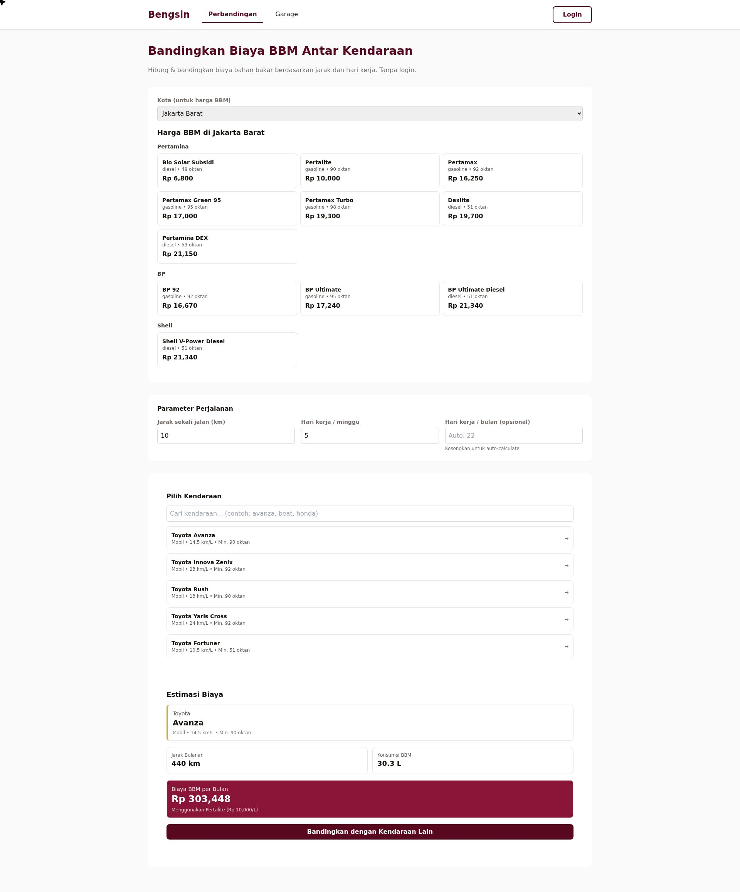

# Bengsin

Aplikasi web untuk menghitung biaya bahan bakar bulanan, membandingkan beberapa kendaraan, dan mencatat pengisian BBM harian. Harga BBM mengikuti kota yang dipilih.

Situs: https://bengsin.vercel.app



## Fitur

**Perbandingan biaya tanpa login.** Pilih kota, isi jarak sekali jalan, hari kerja per minggu, lalu pilih kendaraan. Aplikasi menampilkan kilometer bulanan, liter yang dibutuhkan, dan biaya rupiah. Rumusnya: kilometer bulanan = jarak x 2 (pulang pergi) x hari kerja, liter = kilometer / konsumsi kendaraan, biaya = liter x harga BBM termurah yang oktannya memenuhi syarat kendaraan.

**Harga BBM per kota.** Daftar harga Pertamina, BP, dan Shell beserta oktan atau setana. Data awal diisi dari seed, lalu diperbarui oleh sinkronisasi harian.

**Garage.** Setelah login, kendaraan bisa disimpan: merek, model, tipe mesin, konsumsi km per liter, dan oktan minimum. Tersedia pencarian merek mobil dan motor.

**Catatan pengisian.** Setiap pengisian dicatat sebagai liter, total biaya, dan tanggal. Riwayat tampil per kendaraan dan bisa dihapus.

**Ringkasan bulanan.** Total liter dan total rupiah per bulan, diambil dari catatan pengisian.

**Akun.** Registrasi, login, refresh token, dan logout. Password di-hash dengan bcrypt, sesi memakai JWT.

## Cara kerja data

Kendaraan preset berisi 20 mobil dan motor dengan konsumsi km per liter. Perhitungan biaya berjalan di browser, jadi halaman perbandingan tetap bisa dipakai tanpa akun. Server hanya menyimpan akun, kendaraan milik pengguna, dan catatan pengisian.

Harga BBM disimpan per kota. Sinkronisasi harian menarik data publik MyPertamina dari mirror `nasgunawann/bensin-api`, memetakan 40 provinsi menjadi baris kota, dan hanya menulis ulang baris yang harganya berubah.

## API

| Metode | Path | Keterangan |
| --- | --- | --- |
| GET | `/health` | Status server |
| POST | `/auth/register` | Daftar akun |
| POST | `/auth/login` | Login, mengembalikan access dan refresh token |
| POST | `/auth/refresh` | Perbarui access token |
| POST | `/auth/logout` | Cabut refresh token |
| GET | `/auth/me` | Profil pengguna aktif |
| GET | `/cities` | Daftar kota |
| GET | `/fuel-prices` | Harga BBM, bisa difilter `city_id` |
| GET | `/presets` | Kendaraan preset |
| GET | `/car-brands`, `/motorbike-brands` | Merek kendaraan |
| GET, POST | `/garage/` | Daftar dan tambah kendaraan milik pengguna |
| DELETE | `/garage/{id}` | Hapus kendaraan |
| GET, POST | `/expenses/` | Riwayat dan tambah catatan pengisian |
| DELETE | `/expenses/{id}` | Hapus catatan |
| GET | `/expenses/monthly-summary` | Total liter dan rupiah per bulan |
| GET, POST | `/cron/fuel-sync` | Jalankan sinkronisasi harga |

Dokumentasi interaktif tersedia di `/docs`, skema OpenAPI di `/openapi.json`.

## Sinkronisasi harga harian

Vercel Cron memanggil `GET /cron/fuel-sync` sekali sehari pada `0 22 * * *` UTC, atau 05.00 WIB. Fungsi menarik JSON sekitar 57 KB lalu melakukan upsert, selesai dalam dua sampai tiga detik.

Sumber datanya mirror publik, bukan situs Pertamina langsung. Halaman Pertamina memakai Blazor, sehingga harga baru muncul setelah JavaScript berjalan dan tidak bisa dibaca fungsi serverless tanpa browser.

Bila `CRON_SECRET` diisi, endpoint hanya menerima header `Authorization: Bearer <CRON_SECRET>`. Pertamina mengubah harga beberapa kali sebulan, sedangkan mirror memperbarui tiap jam, jadi jadwal harian sudah lebih dari cukup.

## Menjalankan lokal

```bash
python3.11 -m venv .venv
.venv/bin/pip install -r api/requirements.txt
cd api && ../.venv/bin/python -m uvicorn app.main:app --reload --port 8000
```

Atau dari akar repo:

```bash
.venv/bin/python run.py
```

Buka http://127.0.0.1:8000. Tanpa `DATABASE_URL`, aplikasi memakai SQLite lokal di folder `api/`.

## Environment

| Variabel | Wajib | Keterangan |
| --- | --- | --- |
| `DATABASE_URL` | Produksi | Koneksi Postgres. Di Vercel, SQLite tidak bertahan antar panggilan. |
| `SECRET_KEY` | Produksi | Kunci tanda tangan JWT. |
| `CRON_SECRET` | Disarankan | Mengunci endpoint sinkronisasi. |
| `FUEL_PRICE_URL` | Tidak | Menimpa URL sumber harga. |

## Struktur repo

```
api/
  index.py            entrypoint Vercel
  app/
    main.py           aplikasi FastAPI, mount frontend
    models.py         tabel SQLAlchemy
    routers/          auth, garage, expenses, vehicles, brands, cron
    services/         fuel_sync.py
bengsin-frontend/
  index.html          satu halaman, tiga bagian
  app.js              state, render, panggilan API
vercel.json           build Python, rewrite, jadwal cron
run.py                launcher lokal
```

## Lisensi

Proprietary, proyek pribadi.
