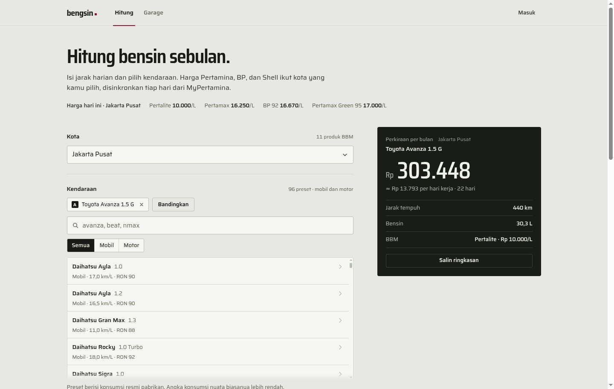

# Bengsin

Kalkulator biaya bensin bulanan untuk mobil dan motor di Indonesia. Pilih kota, isi
jarak harian, dan aplikasi menghitung liter serta rupiah yang keluar sebulan memakai BBM
termurah yang cocok dengan mesin kendaraan.

Situs: https://bengsin.vercel.app



## Isi

**Hitung tanpa akun.** Kota, kendaraan, jarak sekali jalan, dan hari kerja per minggu.
Jaraknya diatur dengan menggeser mobil di lintasan — atau mengetik angkanya kalau butuh
presisi. Hasilnya: kilometer sebulan, liter yang dibutuhkan, dan biaya rupiah. Dua
kendaraan bisa dibandingkan berdampingan, lengkap dengan selisih per bulan — dan sejak
pembaruan terakhir, keduanya berdiri di atas panggung 3D: mobil ya mobil, motor ya motor,
bisa diputar dengan menggeser.

**Papan harga.** Harga Pertamina, BP, dan Shell per liter di kota yang dipilih, urut dari
termurah, ditandai mana yang dipakai kendaraanmu dan mana yang tidak cocok. Tiap baris
juga menunjukkan biaya bulanan kalau kamu memakai BBM itu, jadi "pindah ke Pertamax"
bisa dijawab tanpa hitung ulang.

**Garage.** Setelah masuk, kendaraan disimpan dengan merek, model, tipe mesin, konsumsi
km/L, dan oktan minimum.

**Catatan pengisian.** Total bayar dan liter per pengisian, dikelompokkan per bulan
dengan subtotal. Semua bisa dihapus.

## Cara menghitung

```
km/bulan  = jarak sekali jalan × 2 × hari kerja per bulan
hari kerja = ⌈30 × hari per minggu ÷ 7⌉        (5 hari → 22 hari)
liter     = km/bulan ÷ konsumsi (km/L)
biaya     = liter × harga BBM termurah yang cocok
```

BBM dianggap cocok kalau jenisnya sama dengan mesin (bensin atau diesel) dan angka
oktannya memenuhi oktan minimum kendaraan. Semua perhitungan berjalan di browser.

## Data

- 118 kota, dipetakan dari 40 provinsi pada sumber harga.
- 97 preset kendaraan (68 mobil, 29 motor) berisi konsumsi resmi pabrikan. Preset dengan
  tenaga listrik disembunyikan karena API hanya mengenal bensin dan diesel.
- 818 baris harga dari tiga merek. Dua sumber data tumpang tindih; klien membuang
  duplikatnya dan memilih baris dengan nama produk yang rapi.

Harga disinkronkan sekali sehari dari mirror publik MyPertamina, bukan dari situs
Pertamina langsung (halamannya Blazor, harga baru muncul setelah JavaScript jalan).
Endpoint `/cron/fuel-sync` hanya menulis ulang baris yang harganya berubah.

## API

| Metode | Path | Keterangan |
| --- | --- | --- |
| GET | `/health` | Status server |
| POST | `/auth/register` | Daftar akun |
| POST | `/auth/login` | Login, mengembalikan access dan refresh token |
| POST | `/auth/refresh` | Perbarui access token |
| POST | `/auth/logout` | Cabut refresh token |
| GET | `/auth/me` | Profil pengguna aktif |
| GET | `/cities` | Daftar kota |
| GET | `/fuel-prices` | Harga BBM, bisa difilter `city_id` |
| GET | `/presets` | Kendaraan preset |
| GET | `/car-brands`, `/motorbike-brands` | Merek kendaraan |
| GET, POST | `/garage/` | Daftar dan tambah kendaraan milik pengguna |
| DELETE | `/garage/{id}` | Hapus kendaraan |
| GET, POST | `/expenses/` | Riwayat dan tambah catatan pengisian |
| DELETE | `/expenses/{id}` | Hapus catatan |
| GET | `/expenses/monthly-summary` | Total liter dan rupiah per bulan |
| GET, POST | `/cron/fuel-sync` | Jalankan sinkronisasi harga |

Dokumentasi interaktif di `/docs`, skema OpenAPI di `/openapi.json`.

`POST /expenses/` memakai tanggal hari ini; API tidak menerima tanggal lain. Kalau
`CRON_SECRET` diisi, endpoint sinkronisasi hanya menerima `Authorization: Bearer`.

## Menjalankan lokal

```bash
python3.11 -m venv .venv
.venv/bin/pip install -r api/requirements.txt
.venv/bin/python run.py
```

Buka http://127.0.0.1:8000. Tanpa `DATABASE_URL`, aplikasi memakai SQLite di `api/`.
Server yang sama menyajikan `public/`, jadi tidak ada langkah build.

## Environment

| Variabel | Wajib | Keterangan |
| --- | --- | --- |
| `DATABASE_URL` | Produksi | Koneksi Postgres. SQLite tidak bertahan antar panggilan di Vercel. |
| `SECRET_KEY` | Produksi | Kunci tanda tangan JWT. |
| `CRON_SECRET` | Disarankan | Mengunci endpoint sinkronisasi. |
| `FUEL_PRICE_URL` | Tidak | Menimpa URL sumber harga. |

## Struktur

```
api/
  index.py            entrypoint Vercel
  app/
    main.py           aplikasi FastAPI, menyajikan public/
    models.py         tabel SQLAlchemy
    routers/          auth, garage, expenses, vehicles, brands, cron
    services/         fuel_sync.py
public/
  index.html          satu halaman, dua tab
  styles.css          token, layout, komponen
  app.js              state, render, panggilan API
  scene.js            panggung 3D perbandingan (three.js, dimuat saat dipakai)
  models/             GLB kendaraan, CC0 Quaternius
  vendor/             three.js 0.169.0 + GLTFLoader, di-host sendiri
  fonts/              Saira variable, di-host sendiri
  favicon.svg
docs/screenshot.jpg
PRODUCT.md            keputusan produk dan arti angka
DESIGN.md             token, tipe, komponen, state
vercel.json           build Python, rewrite, jadwal cron
run.py                launcher lokal
```

## Kredit

- **three.js** 0.169.0, MIT — `public/vendor/`, termasuk `GLTFLoader` dan
  `environments/RoomEnvironment` untuk pencahayaan studio. Model tiga dimensi dimuat
  lewat import map, tanpa langkah build.
- **Mobil dan motor**: [Quaternius](https://quaternius.com) "Cars Bundle", CC0, diunduh
  lewat [poly.pizza](https://poly.pizza) dan disimpan di `public/models/`.
- **Saira** (Omnibus-Type), SIL Open Font License — `public/fonts/`.

## Lisensi

Proprietary, proyek pribadi. Aset pihak ketiga tetap memakai lisensinya masing-masing.
